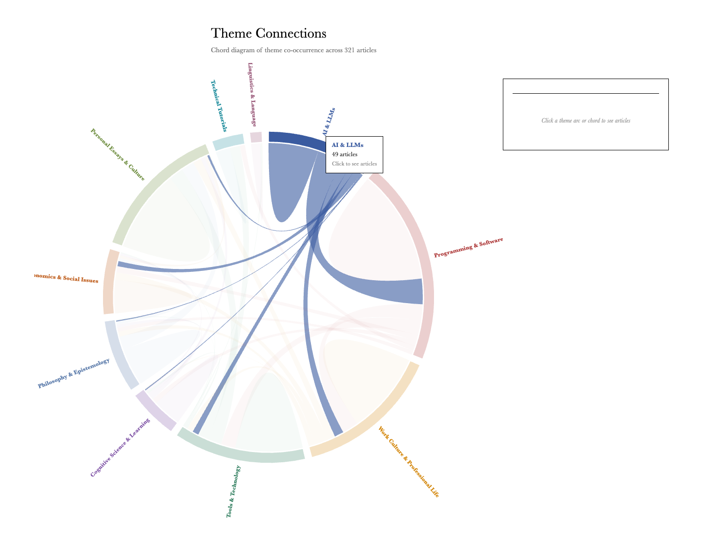

# Theme Connections — Vivek Haldar
> Chord diagram of theme co-occurrence across 321 articles  ·  [vivekhaldar.com](https://vivekhaldar.com/ideaverse/chord.html)

**Vertical:** #vertical/tool-app  ·  **Vibe:** #vibe/minimal #vibe/editorial #vibe/experimental  ·  **Topics:** #topic/writing #topic/productivity  ·  **Mode:** #mode/light

## What it is
A single page from Vivek Haldar's personal “ideaverse” (a knowledge-visualization corner of his site vivekhaldar.com): a D3.js chord diagram titled “Theme Connections,” subtitled “Chord diagram of theme co-occurrence across 321 articles.” It's a self-analytics artifact — he's run his own ~321 blog posts through some theme-extraction pass and is visualizing which pairs of themes tend to appear together in the same piece of writing.

## What it shows
A circular chord diagram with 10 colored theme arcs around the ring — AI & LLMs, Programming & Software Engineering, Work Culture & Professional Life, Tools & Technology, Cognitive Science & Learning, Philosophy & Epistemology, Economics & Social Issues, Personal Essays & Culture, Technical Tutorials, and Linguistics & Language — connected by ribbons whose thickness encodes how often two themes co-occur in the same article. AI & LLMs is clearly the fattest arc with the thickest ribbons, dominated by a strong connection to Programming & Software Engineering and a secondary one to Work Culture & Professional Life, while most other themes are linked by thin, low-saturation threads. An empty results panel (“Click a theme arc or chord to see articles”) sits to the right of the diagram.

## How it works
Hovering a theme arc (confirmed on “AI & LLMs”) highlights it and pops a small tooltip reading the theme name, its article count (“49 articles”), and “Click to see articles” — clicking presumably filters the side panel to the underlying article list, though that click-through wasn't exercised in this pass. It's built directly on D3 v7 (loaded from the d3js.org CDN) plus a same-origin `articles-data.js` payload — no framework, no build step, no analytics: just a static HTML file, D3, and a JSON-like data file computing and rendering the chord layout client-side.

## How it's designed
Restrained, print-like chrome: the `<h1>` and body copy render in a `baskerville, palatino, georgia, serif` stack (confirmed via `getComputedStyle`; `document.fonts` is empty, so this is a pure system/fallback serif — no webfont is fetched at all) on a plain white page (`rgb(255,255,255)` background, `rgb(0,0,0)` text; no CSS custom properties are defined anywhere on the page). All color comes from the visualization itself: each of the 10 theme arcs has its own D3-assigned hex fill (verified per-arc via the SVG `<g>`/`<path>` pairing) — AI & LLMs `#3a5ba0`, Programming & Software Engineering `#b04040`, Work Culture & Professional Life `#d4880e`, Tools & Technology `#2a7a5a`, Cognitive Science & Learning `#7b4ea3`, Philosophy & Epistemology `#5a7aaa`, Economics & Social Issues `#c06020`, Personal Essays & Culture `#6a8a3a`, Technical Tutorials `#1a8a9a`, Linguistics & Language `#9a5a7a` — a muted, desaturated 10-hue set that reads more like a print infographic than a typical SaaS dashboard palette. The whole page is a single SVG (1 `<svg>`, 51 `<path>` elements, zero `<canvas>`/``/`<video>`) at a fixed ~960×960px size that does not respond to viewport width.

## Design data
- **Palette:** White ground, black serif text, 10 muted/desaturated D3-assigned arc hues (navy `#3a5ba0`, brick `#b04040`, amber `#d4880e`, teal-green `#2a7a5a`, plum `#7b4ea3`, slate-blue `#5a7aaa`, burnt-orange `#c06020`, olive `#6a8a3a`, cyan-teal `#1a8a9a`, mauve `#9a5a7a`) — all sampled from rendered SVG fills.
- **Palette tokens:** background: #ffffff (rendered), text: #000000 (rendered), arc-ai-llms: #3a5ba0 (rendered), arc-programming-software: #b04040 (rendered), arc-work-culture: #d4880e (rendered), arc-tools-technology: #2a7a5a (rendered), arc-cognitive-science: #7b4ea3 (rendered), arc-philosophy-epistemology: #5a7aaa (rendered), arc-economics-social-issues: #c06020 (rendered), arc-personal-essays-culture: #6a8a3a (rendered), arc-technical-tutorials: #1a8a9a (rendered), arc-linguistics-language: #9a5a7a (rendered)
- **Fonts:** System/fallback serif stack only — `baskerville, palatino, georgia, serif` — no webfont loaded (`document.fonts` empty).
- **Fonts loaded:** system only (no webfont)
- **Tech stack:** D3.js v7 (CDN: d3js.org), Static HTML/JS, same-origin data file, No analytics detected
- **Keywords:** chord-diagram, d3, data-viz, svg, personal-corpus-analysis, theme-co-occurrence, fixed-width-not-responsive, self-analytics
- **Media mix:** svg 1
- **Page height:** 1096px (single-screen: False)
- **Responsive:** At 390×844 the fixed ~960px-wide D3 SVG doesn't reflow or scale — its bounding box runs from roughly −455px to 505px, overflowing both viewport edges and forcing horizontal scroll; no breakpoint, hidden nav, or layout change was detected (there's no nav to begin with).
- **Headings:** Theme Connections
- **Weight:** 3 requests; hosts: d3js.org, vivekhaldar.com
- **Extracted:** 2026-07-14 · Playwright MCP, viewports 1440×900 (primary capture + DOM probe) and 390×844 (responsive check); logged_out: true (no auth required — static personal-site page).

## Related sites
- [[serif.sh]] — shared: tool-app, minimal, editorial, writing, light
- [[geniusmargins.com]] — shared: minimal, editorial, writing, productivity, light
- [[zendex.spyrosigma.in]] — shared: tool-app, minimal, writing, productivity
- [[sensory-ui.com]] — shared: tool-app, minimal, editorial, light
- [[anyblockers.com]] — shared: minimal, editorial, writing, light
- [[manus.im]] — shared: minimal, editorial, productivity, light
