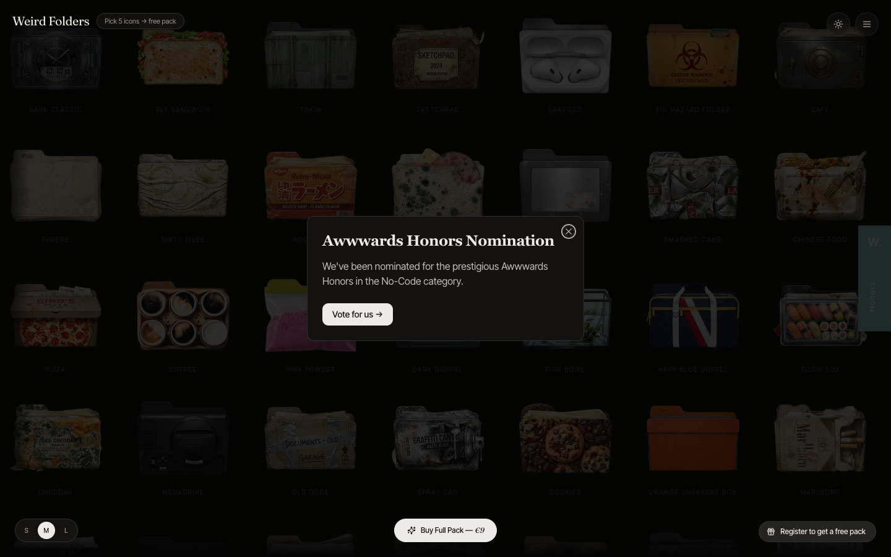

# Weird Folders — Custom Folder Icons for Mac & PC
> Custom Folder Icons for your Operative System, download a free pack or learn to make them yourself  ·  [weirdfolders.com](https://weirdfolders.com)

**Vertical:** #vertical/ecommerce  ·  **Vibe:** #vibe/playful #vibe/minimal  ·  **Topics:** #topic/design  ·  **Mode:** #mode/dark

## What it is
A freemium storefront selling custom folder icons for Mac and PC, disguised as a playful collection you browse. There's no marketing preamble — you land directly inside the product. The whole pitch is 'here are ~100 weird little folder icons; pick a few free, or buy the full pack for €9.'

## What it shows
A single fixed screen packed edge-to-edge with a dense grid of folder icons, each a tiny tactile render of an everyday object — a Green G-Shock, a Pizza Box, a VHS tape, Cheetos, a fish bowl, Marlboros, an iPod, a hard disk. The product literally IS the page. Chrome is minimal: a small top-left 'Weird Folders' wordmark, an Awwwards 'Honors' badge, and a bottom bar holding the buy CTA plus a 'Pick 5 icons → free pack' progress nudge.

## How it works
The grid is a pannable/draggable infinite canvas — you move around the collection spatially rather than scrolling a page (body scroll is disabled). Every icon is a clickable button; clicking selects toward the free-pack unlock. A S/M/L switcher rescales grid density (M by default), acting like a zoom control. Primary action is 'Buy Full Pack — €9'; secondary paths are the gamified 'Pick 5 → free pack' and 'Register to get a free pack.' On load, an interstitial modal interrupts with the Awwwards Honors nomination and a 'Vote for us →' link.

## How it's designed
A near-black ground makes the colorful icon renders pop like objects laid out on a dark table — the page is all product, no decoration. Icons are drawn on ~99 individual <canvas> elements (not ), giving them a crisp, almost 3D product-shot quality and enabling per-icon hover/scale animation (transitions/transforms run heavy across the page). Typography is deliberately quiet so the icons carry the personality: Inter Tight for all UI text, with Fraunces serif reserved for accent headings like the modal title (24px, semibold, slightly tightened tracking). Built on Tailwind + shadcn; tellingly, the underlying design-token system is actually a warm cream/stone LIGHT palette, deliberately overridden to near-black for this gallery view.

## Design data
- **Palette:** Near-black ground (#131211 / #252422), warm off-white text (#edebe8), muted taupe for secondary (#9f9a93); all real color comes from the per-icon renders, plus a light pill for the buy CTA.
- **Fonts:** Inter Tight (body/UI), Fraunces (serif accents)
- **Keywords:** infinite-grid, canvas-gallery, draggable-canvas, gamified-unlock, freemium-storefront, density-toggle, interstitial-modal, dark-mode, tactile-3d, product-is-the-page
- **Extracted:** 2026-06-04 · playwright-mcp @ 1440x900

## Related sites
- [[backgrounds.supply]] — shared: ecommerce, minimal, design, dark
- [[nucleoapp.com]] — shared: ecommerce, minimal, design
- [[templatoria.com]] — shared: ecommerce, minimal, design
- [[designrebuilds.vercel.app]] — shared: playful, minimal, design
- [[drawably.dev]] — shared: playful, minimal, design
- [[gyanl.com]] — shared: playful, minimal, design
