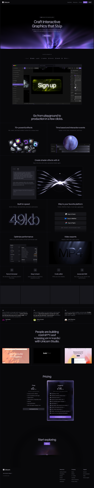

# Unicorn Studio — Craft Interactive Graphics that Ship
> Design production-ready web components with shaders, media, 3D, and interactive motion in a visual canvas.  ·  [www.unicorn.studio](https://www.unicorn.studio/)

**Vertical:** #vertical/startup-product  ·  **Vibe:** #vibe/experimental #vibe/corporate-clean  ·  **Topics:** #topic/design #topic/art  ·  **Mode:** #mode/dark

## What it is
Marketing site for Unicorn Studio, a visual editor for building shader, 3D and interactive-motion web components that embed into production sites.

## What it shows
The h1 is 'Craft Interactive Graphics that Ship', followed by 'Go from playground to production in a few clicks.', a gallery of community work ('People are building cool sh*t (and winning awwwards)') and Pricing.

## How it works
A Vue app (data-v-app root) with PostHog analytics. The page carries 37 video elements and 7 canvases to show effects running live, and 41 inline SVGs.

## How it's designed
Near-black page (body rgb(8,8,10)) with lavender-grey text rgb(218,215,222); the 64px h1 is Overused Grotesk 500 in rgb(174,170,192) with Sprat as a serif accent. The stylesheet defines the editor's own tokens on :root: purple --primary-color #8e6ce4, gold #f1a22b, black #1e1e1e, greys #f5f5f5 to #333 (these are the app's light theme, the marketing page itself renders dark).

## Design data
- **Palette:** Near-black with muted lavender text; purple #8e6ce4 and gold #f1a22b in the token set
- **Palette tokens:** --primary-color: #8e6ce4 (var), --gold: #f1a22b (var), --black: #1e1e1e (var), --gray10: #f5f5f5 (var), body bg: rgb(8, 8, 10) (rendered), body color: rgb(218, 215, 222) (rendered), h1 color: rgb(174, 170, 192) (rendered)
- **Fonts:** Overused Grotesk 500, Sprat 500
- **Fonts loaded:** Overused Grotesk 500, Sprat 500
- **Tech stack:** Vue, PostHog, WebGL canvas
- **Keywords:** shader showcase, video wall, dark product page, editor-to-production pitch
- **Media mix:** img 8 · canvas 7 · video 37 · svg 41
- **Page height:** 7396px (single-screen: False)
- **Responsive:** At 390px the h1 shrinks from 64px to 48px and the page grows from 7396px to 10283px as columns stack; no horizontal overflow.
- **Headings:** Craft Interactive Graphics that Ship / Go from playground to production in a few clicks. / People are building cool sh*t (and winning awwwards) with Unicorn Studio. / Pricing
- **Extracted:** 2026-10-17 · Playwright 1440x900 full-page + DOM probe; 390x844 text probe; logged_out: true

## Related sites
- [[cavalry.studio]] — shared: startup-product, corporate-clean, design, dark
- [[lenis.dev]] — shared: startup-product, experimental, design, dark
- [[backgrounds.supply]] — shared: experimental, design, art, dark
- [[fabra.com]] — shared: startup-product, corporate-clean, design
- [[gatheros.co]] — shared: startup-product, corporate-clean, design
- [[shadergradient.co]] — shared: experimental, design, art, dark
