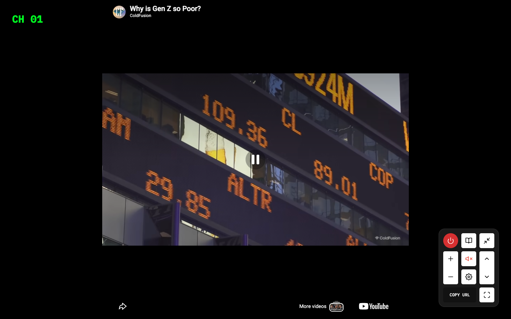

# YTCH
> If Youtube had actual channels.  ·  [ytch.tv](https://ytch.tv/)

## What it is
A playful web toy that reimagines YouTube as broadcast television. Instead of an algorithmic feed you 'tune' to numbered channels (CH 01, CH 02…) of curated videos and flip between them with an on-screen remote — the whole conceit, per the meta description, is 'If Youtube had actual channels.' Reached via ytch.xyz, which redirects to ytch.tv.

## What it shows
A single full-black screen. Centered is a video frame currently playing a YouTube clip ('Why is Gen Z so Poor?'); a glowing green monospace 'CH 01' channel readout sits top-left like a cable-box overlay. Bottom-right is a skeuomorphic remote control with a 0–9 numeric keypad and power/record-style buttons. Small chrome at the bottom reads 'COPY URL', 'More videos', and a YouTube logo.

## How it works
One fixed, non-scrolling screen (exactly 900px, no body scroll). The clip is an embedded YouTube IFrame-API player (script host www.youtube.com, the page's single iframe); the number keys / remote keypad switch channels, and 'COPY URL' shares the current channel. Google Tag Manager and the Cloudflare insights beacon are the only other scripts.

## How it's designed
A pure retro-terminal aesthetic. Black ground (rgb(0,0,0)) with IBM Plex Mono (500 and 700, loaded from Google Fonts) for everything, and the channel readout in a vivid CRT green (rgb(0,255,34)) that deliberately evokes an old cable box / tuner display; the 'COPY URL' label is plain white. No SVG and no canvas — the UI is built from 14 raster sprites (the remote, buttons) plus the one video iframe. It's deliberately minimal, single-screen and keyboard-driven, all atmosphere and interaction rather than content layout.

## Design data
- **Palette:** Black ground (#000), vivid CRT green channel readout (rgb(0,255,34)), white secondary text — high-contrast retro tuner look.
- **Palette tokens:** root-bg: rgb(0, 0, 0) (rendered), channel-readout: rgb(0, 255, 34) (rendered), copy-url-text: rgb(255, 255, 255) (rendered)
- **Fonts:** IBM Plex Mono (500 & 700), loaded via Google Fonts.
- **Fonts loaded:** IBM Plex Mono 500, IBM Plex Mono 700
- **Tech stack:** YouTube IFrame API, Google Tag Manager, Cloudflare (insights)
- **Media mix:** img 14 · iframe 1
- **Page height:** 900px (single-screen: True)
- **Responsive:** At 390px it stays a single fixed screen (no scroll); the centered video frame shrinks to ~234px wide and the remote/keypad reflow to fit.
- **Extracted:** 2026-06-06 · playwright-mcp @ 1440x900 + 390x844 mobile (ytch.xyz redirects to ytch.tv); logged_out: true

## Related sites
[[akira.sachi.dev]] [[davekrugman.com]] [[khairallah.xyz]] [[killedbyopenai.com]] [[axiaisacat.indiehacker.bio]] [[backgrounds.supply]]

## Tags
#category/uncategorized #aesthetic/retro #aesthetic/developer-product #aesthetic/dark #pattern/web-toy #pattern/retro-tv #pattern/crt-aesthetic #pattern/channel-zapping #pattern/youtube-iframe-api #pattern/skeuomorphic-remote #pattern/keyboard-driven #pattern/single-screen #pattern/monospace #pattern/dark-mode #tech/youtube-iframe-api #tech/google-tag-manager #tech/cloudflare-insights #color/dark #color/cool #font/ibm-plex-mono
