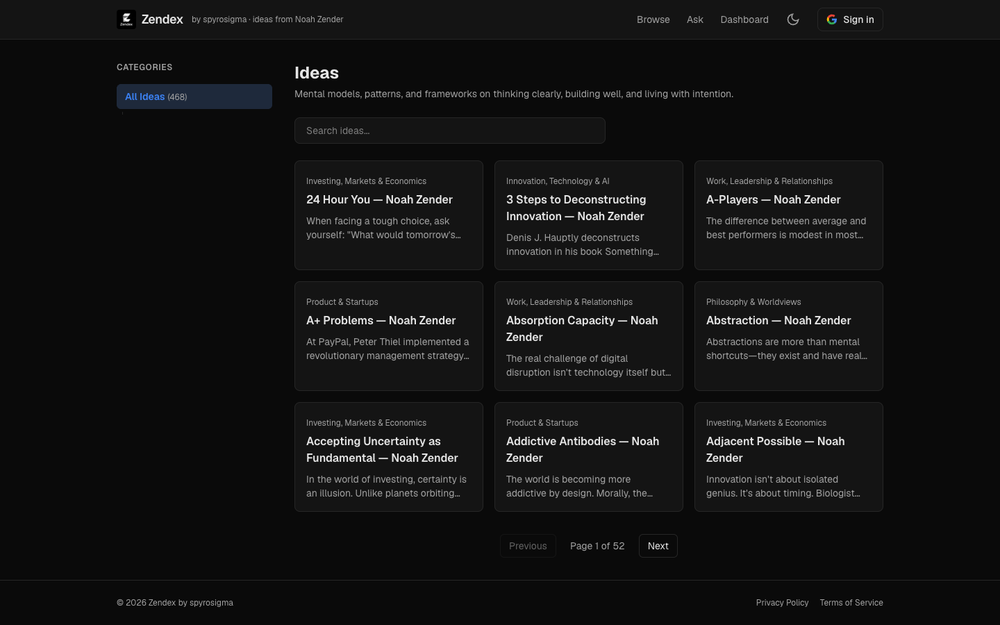

# Zendex
> Mental models, patterns, and frameworks on thinking clearly, building well, and living with intention.  ·  [zendex.spyrosigma.in](https://zendex.spyrosigma.in/)

**Vertical:** #vertical/tool-app  ·  **Vibe:** #vibe/minimal #vibe/technical  ·  **Topics:** #topic/productivity #topic/writing  ·  **Mode:** #mode/dark

## What it is
A searchable index of Noah Zender's open-sourced ideas, built by Satyam Namdev (@Spyrosigma): "@noahzender open sourced 468 ideas on mental models, startups, psychology, and life. So, I built Zendex — his entire mind, indexed." The header bills it as "Zendex — by spyrosigma · ideas from Noah Zender." You can search it, browse it, ask it, and get a daily idea on Telegram.

## What it shows
A dark dashboard. A top bar carries the Zendex logo, a Browse / Ask / Dashboard nav, a light/dark toggle and a Google "Sign in" button. A left CATEGORIES sidebar ("All Ideas (0)") sits beside the main column, which opens with an "Ideas" heading, the subtitle about mental models and frameworks, a "Search ideas…" box and a grid of idea cards — here rendered empty (the count reads 0, so the cards show as blank placeholders). A footer reads "© 2026 Zendex by spyrosigma" with Privacy / Terms links.

## How it works
It's an app, not a static page: a category filter sidebar, a full-text search box, Browse / Ask / Dashboard modes and Google auth drive an idea-retrieval experience, with a Telegram channel pushing one idea a day. The single-screen shell stays fixed while the card grid is the scrollable content region.

## How it's designed
A clean dark utility built on Tailwind v4 design tokens: a near-black background (--color-background #0a0a0a) with slightly lighter cards (--color-card #141414), light-grey body text (--color-foreground #e5e5e5), muted grey labels (--color-muted #a1a1a1), hairline borders (--color-border #262626) and a single blue accent (--color-accent #3b82f6) used for the active category pill. Type is Geist (UI) with Geist Mono reserved for mono — only Geist 400 actually loads. The restraint (one accent, generous spacing, a quiet sidebar) gives a second-brain reference tool a calm, focused feel.

## Design data
- **Palette:** Near-black bg (#0a0a0a), card (#141414), light-grey text (#e5e5e5), muted grey (#a1a1a1), blue accent (#3b82f6), hairline border (#262626).
- **Palette tokens:** --color-background: #0a0a0a (var), --color-card: #141414 (var), --color-foreground: #e5e5e5 (var), --color-muted: #a1a1a1 (var), --color-border: #262626 (var), --color-accent: #3b82f6 (var), body background: rgb(10,10,10) (rendered), body text: rgb(229,229,229) (rendered)
- **Fonts:** Geist (UI) + Geist Mono (mono); only Geist 400 actually loaded.
- **Fonts loaded:** Geist 400
- **Tech stack:** Tailwind CSS v4 (oklch tokens), Geist (self-hosted)
- **Keywords:** dark-mode, dashboard, sidebar-filter, search, card-grid, auth-gated, index-directory, second-brain, tailwind
- **Media mix:** img 1 · svg 2
- **Page height:** 900px (single-screen: True)
- **Responsive:** At 390x844 the idea grid collapses to a single ~342px column and total height grows to ~1,878px; the categories sidebar and inline nav (Browse/Ask/Dashboard/Sign in) persist.
- **Headings:** CATEGORIES / Ideas
- **Links out:** [Noah Zender (source)](https://www.noahzender.com/)
- **Extracted:** 2026-06-05 · playwright-mcp @ 1440x900 + mobile 390x844, logged_out: true

## Related sites
- [[ditther.com]] — shared: tool-app, minimal, technical, dark
- [[tryponcho.com]] — shared: tool-app, technical, productivity, dark
- [[akira.sachi.dev]] — shared: tool-app, minimal, technical
- [[itshover.com]] — shared: tool-app, minimal, technical
- [[serif.sh]] — shared: tool-app, minimal, writing
- [[cafe.endofday.studio]] — shared: tool-app, productivity, dark
