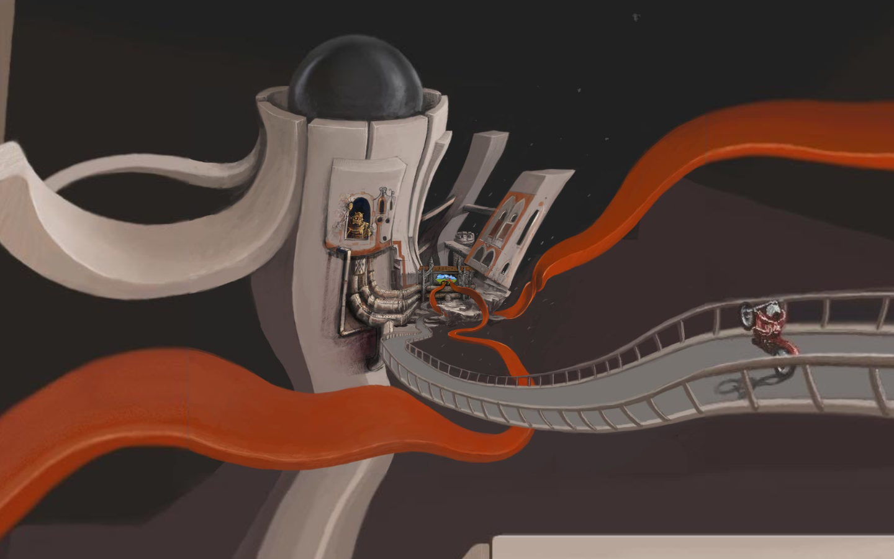

# The Zoomquilt — the infinitely zooming painting
> A collaborative infinitely zooming painting.  ·  [zzz.zoomquilt.org](https://zzz.zoomquilt.org/)

**Vertical:** #vertical/experiment-art  ·  **Vibe:** #vibe/experimental #vibe/retro  ·  **Topics:** #topic/art  ·  **Mode:** #mode/dark

## What it is
The Zoomquilt — 'a collaborative infinitely zooming painting,' created in 2004 by Nikolaus Baumgarten with a collective of artists. It's the 'infinite zoom painting' from Jonas's list and one of the oldest icons of the creative web.

## What it shows
A seamless, endless downward zoom through a surreal hand-painted world — alpine meadows, mountains, trees, curling orange tendrils, caverns — where each scene dissolves into the next in an infinite loop. Up/down keys change the zoom, and an 'About the Zoomquilt' panel credits the participating artists.

## How it works
A 2D <canvas> animation (no WebGL) compositing layered painted images (8 img), driven by classic jQuery (ajax.googleapis.com). It's monetised with Google AdSense (3 ad iframes, pagead2.googlesyndication.com) and fronted by Cloudflare; a fixed single-screen stage (scrollHeight 0).

## How it's designed
Pure content-forward — the painting is the design. Chrome is minimal: from getComputedStyle the stage is black (body rgb(0,0,0)) with grey helper text (rgb(170,170,170)) in a Helvetica/Arial system stack, and the 'About' heading in Open Sans at 40px in a signature orange-red (rgb(255,82,25)). There's no CSS design system or custom properties — it predates them; the loaded Google Sans webfonts come from the AdSense frame, not the artwork.

## Design data
- **Palette:** A black stage (rgb(0,0,0)) with grey UI text (rgb(170,170,170)) and an orange-red heading accent (rgb(255,82,25)); all real colour lives in the painted artwork.
- **Palette tokens:** body background: rgb(0, 0, 0) (rendered), body text: rgb(170, 170, 170) (rendered), About heading: rgb(255, 82, 25) (rendered)
- **Fonts:** Open Sans for the 'About' heading (40px) and a Helvetica/Arial system stack for body text; Google Sans is present only via the ad frame.
- **Fonts loaded:** Google Sans 400 (ad frame), Google Sans 700 (ad frame)
- **Tech stack:** jQuery, HTML5 Canvas (2D), Google AdSense, Cloudflare
- **Keywords:** infinite-zoom, canvas, generative-art, collaborative, surreal-painting, classic-web, 2004
- **Media mix:** img 8 · canvas 1 · svg 2 · iframe 3
- **Page height:** 900px (single-screen: True)
- **Responsive:** At 390x844 the <canvas> scales fluidly to the viewport width and stays a full-screen zoom; the 'Up and down keys' hint gives way to touch/scroll.
- **Headings:** The Zoomquilt / About the Zoomquilt
- **Extracted:** 2026-07-05 · Playwright MCP, 1440x900 + 390x844 mobile pass, logged_out: true

## Related sites
- [[iacopoapps.appspot.com]] — shared: experiment-art, experimental, art, dark
- [[ytch.tv]] — shared: experiment-art, retro, dark
- [[backgrounds.supply]] — shared: experimental, art, dark
- [[bird.onethreenine.net]] — shared: experiment-art, art
- [[mrdoob.com]] — shared: experimental, art, dark
- [[poolsuite.net]] — shared: experiment-art, retro
